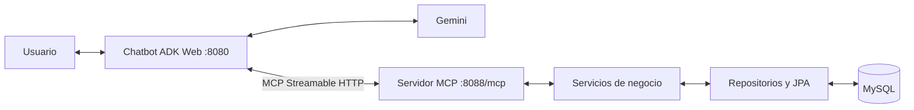
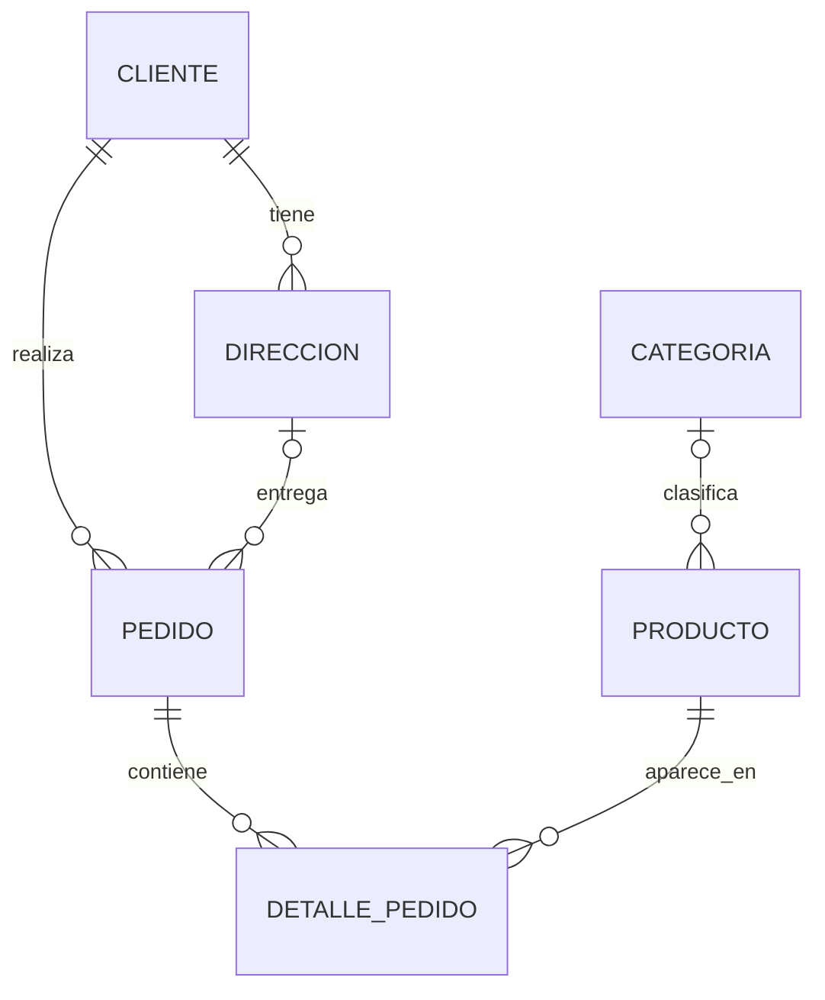

# Chatbot de pedidos de supermercado con MCP

Este proyecto conecta un chatbot con un servidor MCP que consulta una base de datos de supermercado y permite preparar y confirmar pedidos a domicilio.

## Contexto y objetivo

El trabajo corresponde al laboratorio de Arquitectura de Software de Ingeniería de Sistemas de la Universidad de Antioquia, orientado por el profesor Diego José Luis Botia V. La entrega está prevista para el 15 de noviembre de 2026. El ejercicio plantea:

> Realice un cliente de tipo ChatBot e intégrelo con un servidor MCP que conecte a una BD con MySQL, PostgreSQL u otro motor de su elección, para realizar pedidos de productos de un supermercado a domicilio. Explique cada paso que emplee para la solución.

Partimos de la guía del laboratorio, que usa un ejemplo de tareas con Spring Boot, Spring AI, MySQL, Claude Desktop y Google ADK. Adaptamos el dominio a un supermercado y optamos por usar Google ADK como cliente conversacional. En esta implementación no necesitamos Claude Desktop: el agente consume las herramientas del servidor MCP y presenta la conversación mediante ADK Web.

## Arquitectura



Cuando el usuario escribe, el agente envía la conversación al modelo. Si necesita información o una operación del supermercado, el modelo puede solicitar una herramienta MCP. El servidor ejecuta la lógica correspondiente y devuelve el resultado; el agente lo utiliza para responder. El carrito se guarda como un pedido en estado `carrito`. Para confirmarlo, el agente debe presentar el resumen, pedir una dirección y esperar la autorización del usuario. El servidor valida el carrito, actualiza el inventario y cambia el estado a `confirmado`.

## Tecnologías

Las versiones indicadas están declaradas en los archivos Maven de cada proyecto. Las versiones de las dependencias que no aparecen directamente en ellos se gestionan mediante sus respectivos parent o BOM.

| Tecnología | Versión o uso |
|---|---|
| Java | 21 en ambos proyectos |
| Spring Boot del servidor | 3.4.7 |
| Spring AI del servidor | 1.1.4 |
| Spring Data JPA | Gestionado por Spring Boot del servidor |
| MySQL y MySQL Connector/J | MySQL 8; versión del conector gestionada por Spring Boot |
| Spring Boot del agente | 3.5.16 |
| Google ADK y ADK Dev para Java | 0.6.0 |
| Gemini | `gemini-3.5-flash` configurado en el agente |
| Maven Wrapper | Maven 3.10.0 para el servidor y 3.9.16 para el agente |

## Base de datos

Usamos la base existente `supermercado_mcp` en MySQL. El modelo JPA representa las tablas `categoria`, `cliente`, `direccion`, `producto`, `pedido` y `detalle_pedido`. Una categoría agrupa productos; un cliente tiene direcciones y pedidos; cada pedido contiene detalles asociados a productos y puede tener una dirección de entrega.



Configuramos Hibernate con `ddl-auto=validate` para que valide los mapeos frente al esquema existente sin crearlo ni actualizarlo. También dejamos deshabilitada la inicialización SQL de Spring. El repositorio no contiene un script para crear el esquema ni insertar los datos de ejemplo: para ejecutar el proyecto se necesita una base ya preparada, compatible con las entidades, con el cliente de demostración y sus datos.

## Servidor MCP

En `labmcp` organizamos las entidades en `model`, las consultas en `repository` y las operaciones de negocio en `service`. Los DTO separan los datos que devuelven las herramientas de las entidades JPA. `LabmcpApplication` registra `SupermercadoToolsService` mediante `MethodToolCallbackProvider`.

El servidor usa Streamable HTTP con Spring AI WebMVC, en modo síncrono. Las herramientas de `SupermercadoToolsService` son:

| Herramienta | Parámetros | Operación |
|---|---|---|
| `listar_categorias` | Ninguno | Lista las categorías. |
| `buscar_productos` | `texto`, `categoriaId`, `limite`, opcionales | Busca productos activos por nombre o categoría; el límite permitido es de 1 a 50. |
| `consultar_producto` | `productoId` | Consulta un producto activo. |
| `consultar_disponibilidad` | `productoId`, `cantidad` | Consulta el stock para la cantidad solicitada. |
| `consultar_cliente` | Ninguno | Consulta el cliente de demostración. |
| `listar_direcciones` | Ninguno | Lista las direcciones del cliente de demostración. |
| `crear_carrito` | Ninguno | Obtiene o crea el carrito activo. |
| `agregar_producto_carrito` | `productoId`, `cantidad` | Agrega unidades y fija el precio vigente al agregar el producto por primera vez. |
| `modificar_cantidad_carrito` | `productoId`, `cantidad` | Reemplaza la cantidad de un producto del carrito. |
| `eliminar_producto_carrito` | `productoId` | Elimina un producto del carrito. |
| `consultar_carrito` | Ninguno | Devuelve las líneas y el total del carrito. |
| `confirmar_pedido` | `direccionId` | Confirma el carrito con una dirección del cliente y descuenta el stock. |
| `listar_pedidos` | Ninguno | Lista los pedidos confirmados. |
| `consultar_detalle_pedido` | `pedidoId` | Consulta el detalle de un pedido del cliente. |

Los servicios rechazan cantidades no positivas e identificadores inválidos, verifican la existencia y el estado de los productos y comprueban el stock. El carrito no reserva inventario: el descuento ocurre al confirmar. `PedidoService.confirmarPedido` comprueba que la dirección corresponda al cliente, que el carrito no esté vacío y que todos los productos tengan disponibilidad. La operación usa una transacción y bloqueos pesimistas para el cliente, el carrito y los productos; después actualiza el stock, el total y el estado del pedido. Los errores de negocio se devuelven en una respuesta con `success`, `code`, `message` y `data`.

## Chatbot

En `agentemcp`, `SupermercadoAgent` construye un `McpToolset` con `StreamableHttpServerParameters`. La URL puede configurarse con `MCP_SERVER_URL`; si no se define, el agente usa el servidor local en `http://localhost:8088/mcp`. Al construir `ROOT_AGENT`, consulta las herramientas disponibles y las entrega al agente de Gemini.

El modelo configurado es `gemini-3.5-flash`. En el código dejamos `gemini-3.1-flash-lite` como referencia de respaldo, pero no hay cambio automático de modelo: para usarlo habría que ajustar la configuración del agente.

Las instrucciones indican que el chatbot converse en español, consulte datos reales y no invente productos, precios, existencias ni pedidos. También le piden mostrar el contenido del carrito, los precios, el total y la dirección elegida antes de solicitar una confirmación explícita. Decidimos pedirla porque confirmar cambia el estado del pedido y descuenta inventario; aun así, esta protección depende de que el modelo siga las instrucciones.

## Ejecución en Git Bash

Necesitamos:

- JDK 21 y Git Bash.
- MySQL 8 en ejecución, con `supermercado_mcp` y un esquema compatible con las entidades. El cliente de demostración configurado tiene ID 1.
- Una clave válida de Gemini y acceso al modelo configurado.
- Los puertos 8088 y 8080 disponibles.

Los siguientes pasos parten de la raíz de este repositorio. Los valores se ingresan en la terminal y no se guardan en los comandos. Para `JAVA_HOME`, ingresamos la ruta del directorio del JDK en formato de Git Bash, no la carpeta `bin`.

1. En la primera terminal, configuramos Java y la contraseña de MySQL para el servidor:

   ```bash
   read -r -p "Ruta del JDK 21: " JAVA_HOME
   export JAVA_HOME
   export PATH="$JAVA_HOME/bin:$PATH"
   read -r -s -p "Contraseña de MySQL: " PWD_UDEA
   printf '\n'
   export PWD_UDEA
   java -version
   ```

2. Desde la raíz del repositorio, iniciamos el servidor y esperamos a que termine el arranque:

   ```bash
   cd labmcp
   ./mvnw spring-boot:run
   ```

3. En una segunda terminal de Git Bash, volvemos a ubicarnos en la raíz del repositorio y configuramos Java y la clave de Gemini:

   ```bash
   read -r -p "Ruta del JDK 21: " JAVA_HOME
   export JAVA_HOME
   export PATH="$JAVA_HOME/bin:$PATH"
   read -r -s -p "Clave de Gemini: " GOOGLE_API_KEY
   printf '\n'
   export GOOGLE_API_KEY
   java -version
   ```

   Si el servidor MCP está en otra dirección, podemos ingresar y exportar `MCP_SERVER_URL` en esta terminal antes de iniciar el agente:

   ```bash
   read -r -p "URL del servidor MCP: " MCP_SERVER_URL
   export MCP_SERVER_URL
   ```

4. Con el servidor MCP ya disponible, iniciamos ADK Web desde la carpeta del agente:

   ```bash
   cd agentemcp
   ./mvnw clean compile exec:java@runAdkWebServer
   ```

5. Abrimos `http://localhost:8080` y seleccionamos `SupermercadoAgent`. Si reiniciamos el servidor MCP, reiniciamos también el agente para que vuelva a establecer la conexión y descubrir sus herramientas.

## Problemas encontrados

| Problema | Qué hicimos |
|---|---|
| Comandos de PowerShell ejecutados en Git Bash | Ajustamos la sintaxis al shell usado: en Git Bash empleamos `export` y `./mvnw`. |
| `release version 21 not supported` | Revisamos `JAVA_HOME` y usamos un JDK 21 para Maven. |
| Hibernate rechazaba el mapeo de `Pedido` | La asociación con `Direccion` mezclaba columnas insertables y no insertables en `@JoinColumns`. Dejamos una sola `@JoinColumn` hacia `direccion_id`; `PedidoService` sigue comprobando que la dirección pertenezca al cliente. Falta validar el arranque contra el esquema real después del cambio. |
| ADK Web mostraba `No agents found` | Un servidor MCP caído impide que el agente complete la carga de herramientas durante su inicialización. También ajustamos el directorio de descubrimiento a la raíz del proyecto; hay que verificar ambos componentes al iniciar. |
| Errores 404 y 503 del modelo | Encontramos un 404 con `gemini-2.5-flash` para cuentas nuevas y respuestas 503 por demanda en otros modelos. Probamos modelos con `curl` y elegimos `gemini-3.5-flash`; dejamos `gemini-3.1-flash-lite` como respaldo manual. La disponibilidad puede cambiar. |

## Pruebas y evidencias

En una ejecución anterior, las ocho pruebas unitarias de `labmcp` terminaron sin fallos. Usan mocks para comprobar el carrito, la confirmación y el registro de herramientas; no levantan MySQL ni prueban una transacción real. El agente tiene además una prueba que carga el contexto Spring, pero no comprueba el descubrimiento MCP ni una conversación.

Para comprobar la inicialización MCP cuando el servidor esté en ejecución, podemos enviar esta solicitud desde Git Bash:

```bash
curl -i http://localhost:8088/mcp \
  -H 'Content-Type: application/json' \
  -H 'Accept: application/json, text/event-stream' \
  --data '{"jsonrpc":"2.0","id":1,"method":"initialize","params":{"protocolVersion":"2025-03-26","capabilities":{},"clientInfo":{"name":"prueba-mcp","version":"1.0"}}}'
```

Una respuesta a `initialize` comprueba ese paso del protocolo, no la conversación ni todas las herramientas. Debemos registrar el resultado de nuestra ejecución y verificar por separado el flujo completo. Las siguientes capturas quedan pendientes:

| Prueba manual | Evidencia pendiente |
|---|---|
| Inicialización MCP mediante `curl` | [CAPTURA: respuesta de initialize MCP] |
| Agente visible en ADK Web | [CAPTURA: selector con SupermercadoAgent] |
| Consulta de categorías y búsqueda de productos | [CAPTURA: categorías y resultados de búsqueda] |
| Consulta de disponibilidad y manejo de stock insuficiente | [CAPTURA: disponibilidad y respuesta por stock insuficiente] |
| Creación y modificación del carrito | [CAPTURA: productos, cantidades y total del carrito] |
| Resumen y solicitud de confirmación | [CAPTURA: resumen y autorización antes de confirmar] |
| Confirmación y consulta del pedido | [CAPTURA: pedido confirmado y detalle] |

Las capturas son marcadores, no resultados de pruebas. Confirmar un pedido modifica la base y el inventario, por lo que debemos hacerlo únicamente con datos de prueba autorizados.

## Seguridad y limitaciones

Usamos variables de entorno para la contraseña de MySQL y la clave de Gemini; no deben incluirse sus valores en el repositorio ni en capturas. El endpoint MCP no tiene autenticación configurada y está pensado para un entorno local controlado. Antes de exponerlo a una red se necesita una capa de autenticación y autorización.

El servidor trabaja con un único cliente de demostración, ID 1. No implementamos una herramienta para cancelar pedidos ni pagos. La confirmación explícita se solicita mediante el prompt, no mediante una comprobación independiente en el servidor; un cliente MCP que invoque la herramienta directamente no pasa por esa conversación. Las pruebas unitarias tampoco sustituyen las pruebas con MySQL real, la validación del esquema, ni una prueba de integración entre ADK y MCP.

## Estructura y autores

```text
Laboratorio-MCP-Supermercado/
├── labmcp/                 Servidor MCP, servicios, entidades y pruebas
│   ├── src/main/java/
│   ├── src/main/resources/
│   └── src/test/
├── agentemcp/              Agente, configuración de ADK Web y prueba de contexto
│   ├── src/main/java/
│   ├── src/main/resources/
│   └── src/test/
└── README.md
```

Integrantes: [Nombres de los integrantes]
